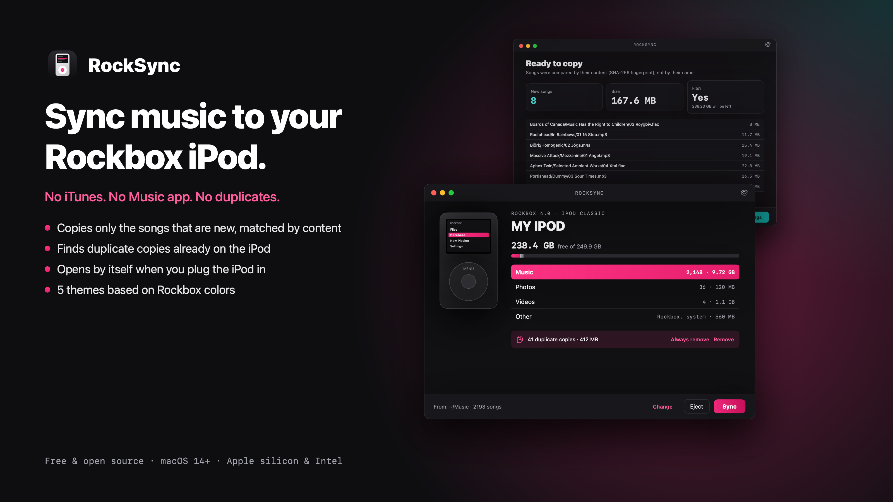
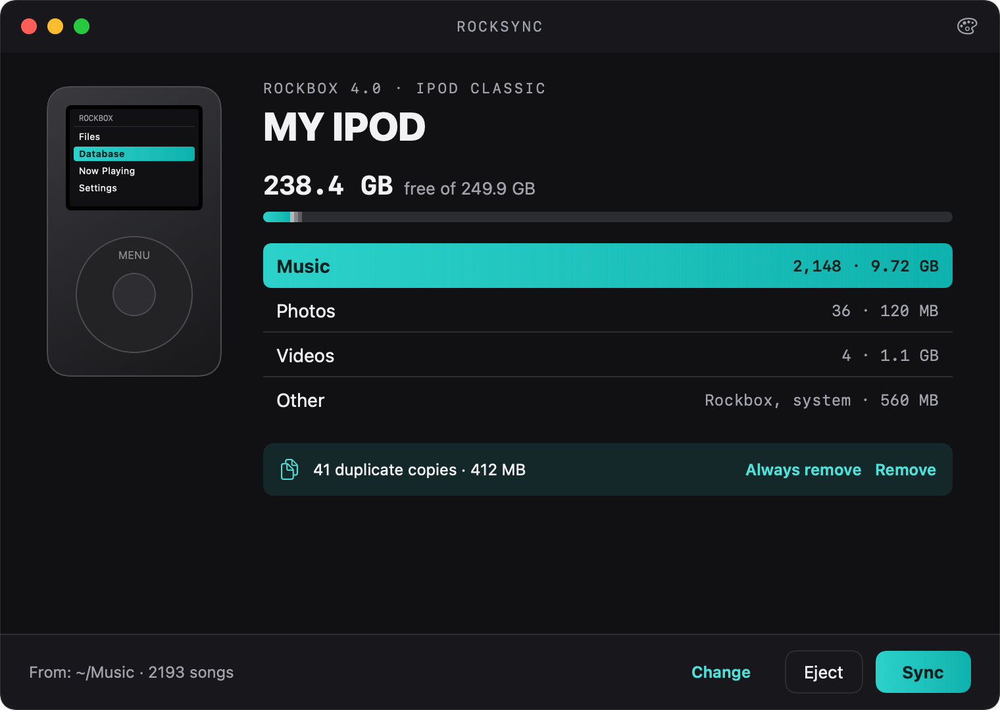
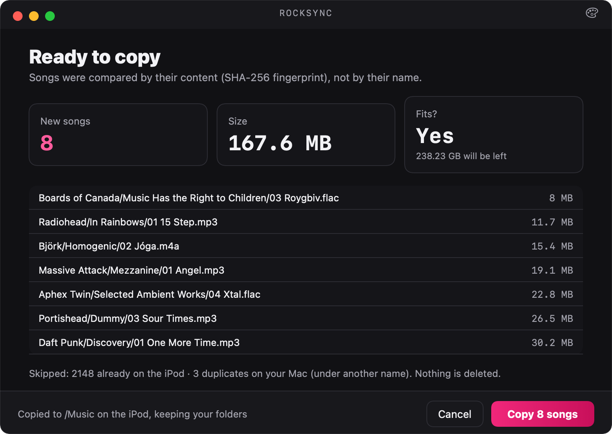
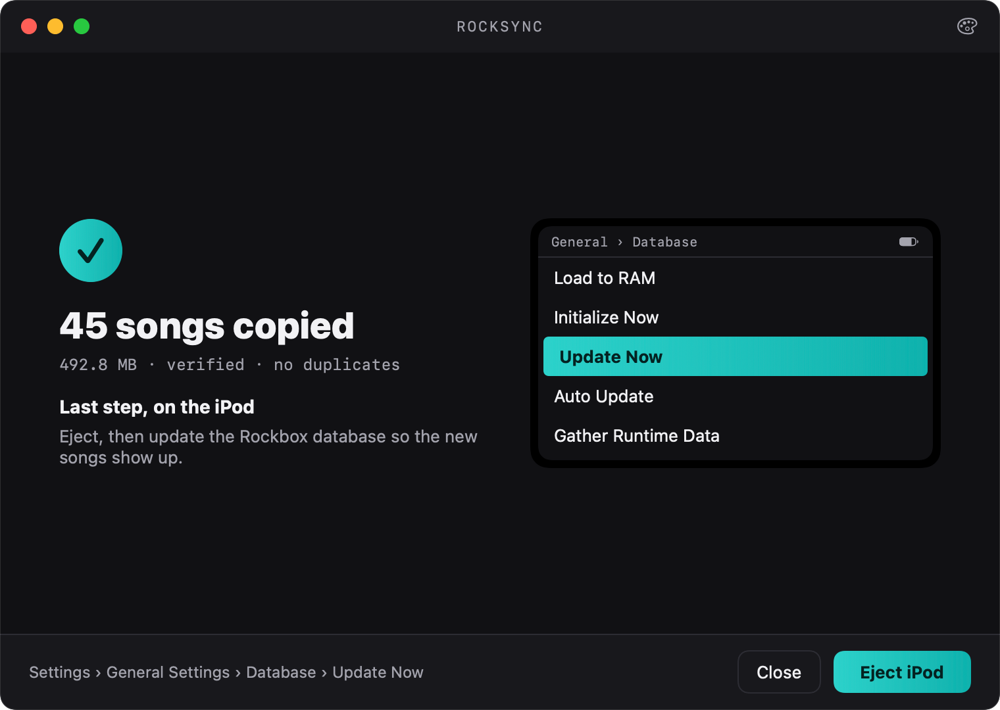
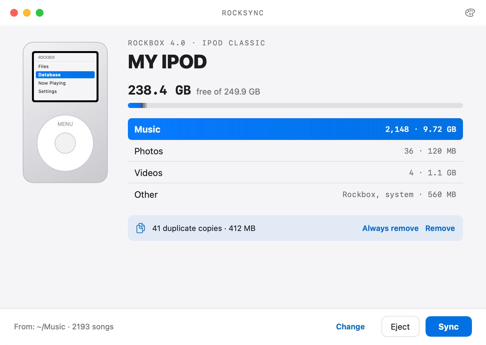

# RockSync

**Sync music to your Rockbox iPod from a Mac — no iTunes, no Music app, no duplicates.**



RockSync is a small menu-bar app for iPods running [Rockbox](https://www.rockbox.org). Plug the iPod in and the window opens by itself:

- **Shows what's on the iPod** — free space, music / photos / videos / other.
- **Copies only what's new.** Songs are matched by their *content* (SHA-256), not by file name, so `Song (1).mp3` or a renamed file never gets copied twice.
- **Tells you before copying** how many new songs there are, how big they are and whether they fit.
- **Finds duplicate copies already on the iPod** (e.g. old iTunes `iPod_Control` leftovers) and removes them only when you say so — or automatically, if you turn that on. One copy is always kept, and every removal is logged.
- **Never deletes anything on your Mac.**
- Reminds you to update the Rockbox database afterwards and ejects the iPod for you.
- 5 themes based on Rockbox colors. English and Spanish.

| | |
|---|---|
|  |  |
|  |  |

## Download & install

1. Download **[RockSync.zip](https://github.com/balmori-max/rocksync/releases/latest/download/RockSync.zip)** and double-click it.
2. Drag **RockSync.app** into your **Applications** folder.
3. Open it. macOS will say it *can't verify the developer* (the app is free and not paid-signed by Apple). Click **Done**, then:
   - Open **System Settings › Privacy & Security**, scroll down and click **Open Anyway** next to “RockSync was blocked”.
   - Confirm with **Open Anyway** and your password. You only do this once.

   *Terminal alternative:* `xattr -dr com.apple.quarantine /Applications/RockSync.app`
4. RockSync appears in the **menu bar** (top right) and will open at login. Plug in your iPod.

Requires macOS 14 (Sonoma) or newer. Works on Apple silicon and Intel Macs.

## How to use

1. Plug in the iPod. The window opens.
2. The first time, choose your music folder with **Change** (defaults to `~/Music`).
3. Press **Sync** → check the list of new songs → **Copy**.
4. **Eject iPod**, then on the iPod: **Settings › General Settings › Database › Update Now** (or *Initialize Now* the first time).

New songs go to the iPod's `Music` folder (or `Musica`, if that's what you already use), keeping your folder structure.

Menu bar options: theme, music folder, *Remove duplicate songs automatically*, *Open at login*, Quit.

## Uninstall

Quit RockSync from the menu bar, then delete `/Applications/RockSync.app`. To also remove its fingerprint cache:

```bash
rm -rf ~/Library/Application\ Support/RockSync
```

## Build from source

Only the Xcode Command Line Tools are needed (`xcode-select --install`):

```bash
./build.sh
```

The app ends up in `build/RockSync.app` (universal binary) and `build/RockSync.zip`.

## Notes

- Tested on an iPod classic (6G/7G) with Rockbox 4.0. Any Rockbox device that mounts as a disk with a `.rockbox` folder should work.
- Fingerprints are cached in `~/Library/Application Support/RockSync`, so only the first comparison is slow.
- Not affiliated with Apple or the Rockbox project. iPod is a trademark of Apple Inc.

## License

MIT
